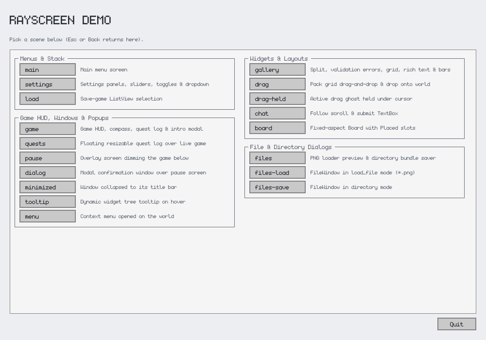
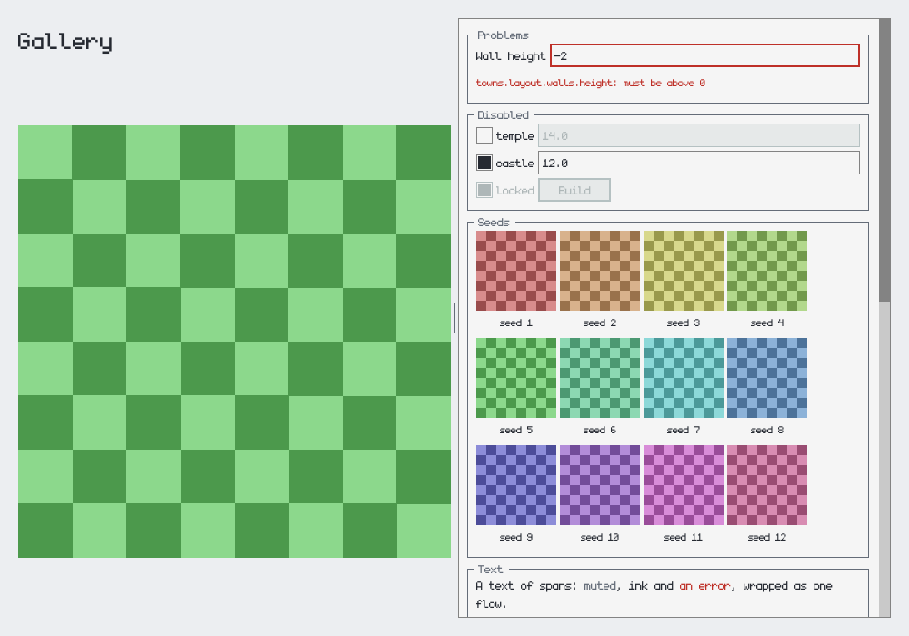
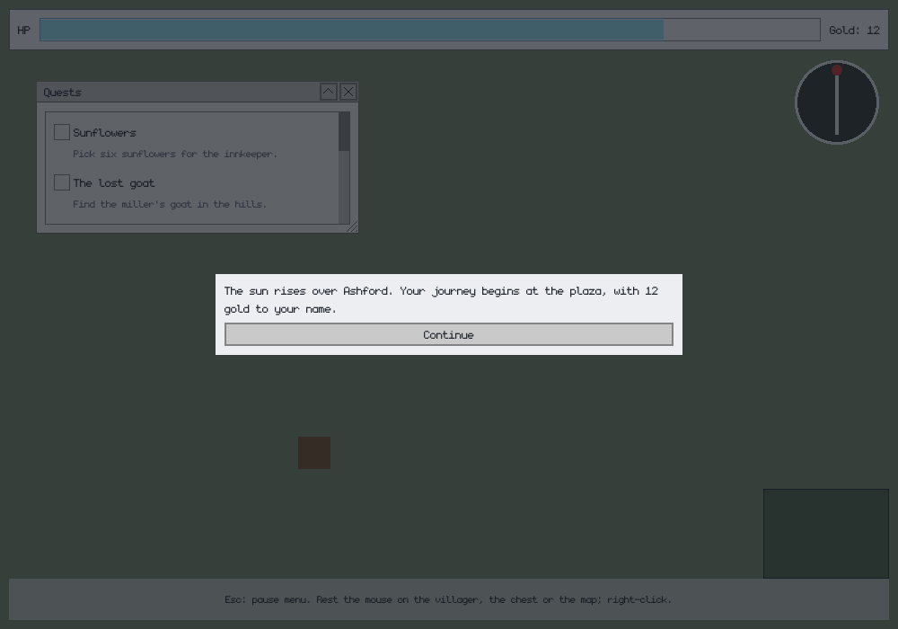
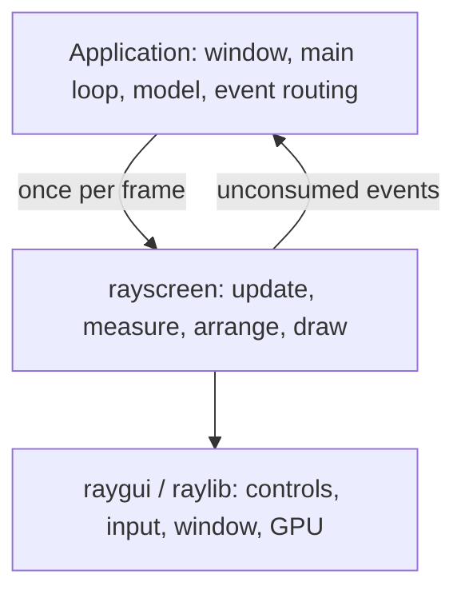
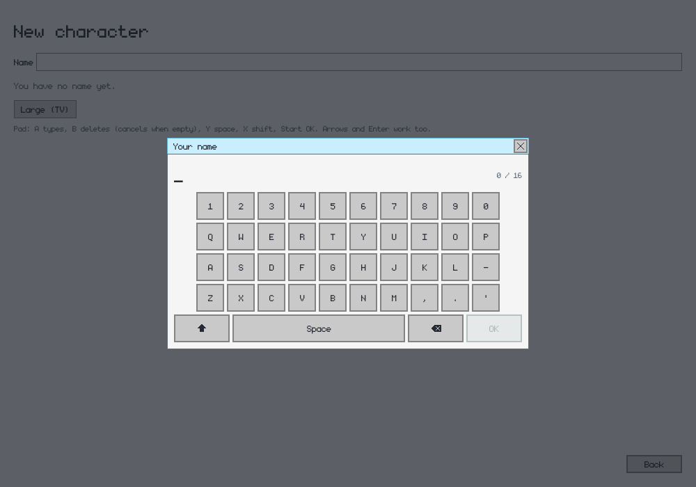
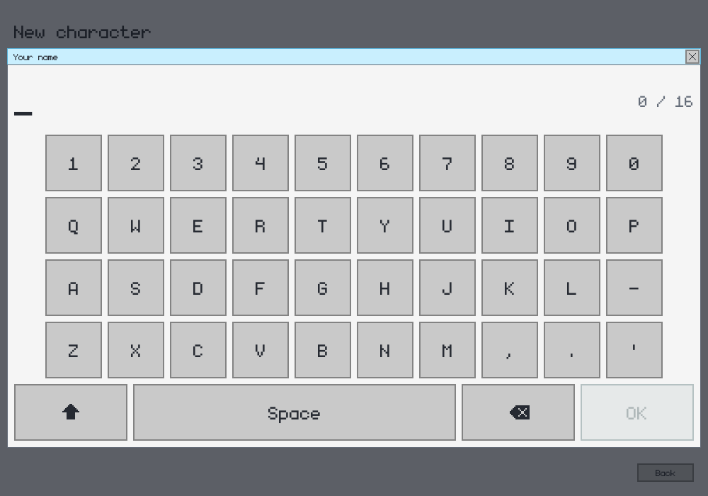

# rayscreen

`rayscreen` is a Python UI library built on [raylib](https://www.raylib.com/) and raygui. It adds declarative widget trees, automatic layout, screen navigation, windows, popups, and persistent interaction state while leaving the application in control of its window and frame loop.

The distribution is named `rayscreen`, and the Python package is imported as `rayscreen`.

## Screenshots

| Scene launcher | Widget gallery |
| --- | --- |
|  |  |

The demo also includes layered application content, floating windows, modal dialogs, and HUD-style widgets:



## Features

- **Declarative widgets:** labels, buttons, toggles, check boxes, sliders, text boxes, dropdowns, progress bars, list views, pictures, colour swatches, rich text, and separators.
- **Composable layouts:** columns, rows, grids, tables, splits, panels, scroll views, fixed-aspect boards, and flexible spacers.
- **Screens and windows:** stacked screens, overlays, modal dialogs, floating windows, dragging, resizing, minimizing, and focus management.
- **Interactions:** tooltips, context menus, drag and drop, keyboard/gamepad-style navigation, and per-screen UI state.
- **Utilities:** file and directory dialogs, an on-screen keyboard for gamepads, data-driven tree rendering, light and dark themes, custom fonts, and display-scaling helpers.
- **Testable layout:** measuring and arrangement are separate from raylib drawing, with text measurement injected by the caller.

## Requirements

- Python 3.13 or newer
- [uv](https://docs.astral.sh/uv/) for the development workflow below
- A platform supported by the pinned `raylib` Python package

## Getting started

Create the development environment and install the package with its test and lint dependencies:

```bash
uv sync
```

Run the interactive demo:

```bash
uv run rayscreen-demo
```

To use a local checkout from another uv project:

```bash
uv add --editable /path/to/rayscreen
```

## Demo

The demo opens a scene launcher by default. Start a particular scene with:

```bash
uv run rayscreen-demo --screen gallery
```

Available scenes are:

- `scenes` — the scene launcher
- `main`, `settings`, `load` — menus and screen-stack navigation
- `game`, `quests`, `pause`, `dialog`, `minimized` — overlays, floating windows, and modal dialogs
- `tooltip`, `menu` — hover tooltips and context menus
- `gallery`, `drag`, `drag-held`, `chat`, `board` — widgets and layout examples
- `files`, `files-load`, `files-save` — file loading and directory selection
- `keyboard`, `keyboard-large` — a name field and the on-screen keyboard it opens for a gamepad, at normal size or
  at a TV's (its form at `text_scale=1.5`, the keyboard at `scale=2`)
- `nav` — a character creation form to move through with the keys or a gamepad, saying where each move goes

Save a screenshot after the demo has drawn a few frames:

```bash
uv run rayscreen-demo --screen gallery --screenshot gallery.png
```

Use `--size W,H` to change the window size, `--mouse X,Y` to hold the pointer at a particular position, and `--focus ID` to start with the focus ring on a widget. The screenshot, mouse, and focus options are useful for repeatable visual checks:

```bash
uv run rayscreen-demo --screen nav --focus gender.prev --screenshot nav.png
```

## Minimal application

The application owns initialization, drawing, and shutdown. rayscreen draws its visible screens when `frame()` is called and returns events that the application can route:

```python
import pyray as rl

from rayscreen import Button, Column, Label, Screen, ScreenManager, Theme, frame

rl.init_window(800, 450, "rayscreen example")
rl.set_exit_key(rl.KeyboardKey.KEY_NULL)
rl.set_target_fps(60)

theme = Theme()
theme.apply_style()
manager = ScreenManager()
manager.push(
    Screen(
        "main",
        Column(
            children=[
                Label("title", "Hello from rayscreen", size=32),
                Button("quit", "Quit"),
            ]
        ),
        margin=24,
    )
)

running = True
while running and not rl.window_should_close():
    rl.begin_drawing()
    rl.clear_background(theme.background)

    for event in frame(manager, theme):
        if event.widget == "quit":
            running = False

    rl.end_drawing()

theme.unload()
rl.close_window()
```

Disable raylib's built-in exit key as shown above if the application uses Escape for navigation. Otherwise, raylib may close the window before rayscreen handles the key.

## Architecture



The ownership boundaries are deliberate:

- The **application** owns its model, window, frame loop, custom rendering, and event routing.
- **rayscreen** owns the screen stack, widget trees, window focus, and interaction state.
- **raygui and raylib** own immediate-mode controls, raw input, fonts and textures, and drawing.

### Specifications and layout

A screen's content is a tree of dataclasses from `rayscreen.specs`. Widgets and containers are ordinary Python objects, so applications can construct or replace trees in response to model changes.

`layout.measure()` calculates desired sizes, `layout.natural_width()` determines widget widths in rows, and `layout.arrange()` assigns rectangles. Text measurement is injected, allowing layout tests to run without opening a window. Most dimensions default to shared metrics such as `ROW`, `GAP`, and `PAD` so independently built screens align consistently.

Weighted children share remaining space. Fixed-size spacers, minimum split sizes, table column alignment, rich-text wrapping, and scroll padding provide finer control where needed.

A `Column` or `Row` with `text_scale` draws the text under it larger (or smaller), down to the next container that sets its own: labels, rich text, the text of buttons, toggles, check boxes, sliders, text boxes, dropdowns, and panel titles, with the icons in a widget's text, and a picture's caption and badge. Default row heights and widths sized to text grow to fit; heights given explicitly, gaps, pads, and popups stay as they are. `Button`, `Toggle`, `Slider`, and `TextBox` also take their own text `size`, which wins over the scale. `layout.text_size()` gives the size a node's text is drawn at. The bundled font is drawn on a 16 px grid, so whole scales are the crispest.

### Screens and navigation

A `Screen` contains a widget tree and may implement:

- `update(dt)` to refresh mutable specification fields from the application model;
- `handle(event)` to consume its own events;
- `hover(x, y)` to provide a tooltip;
- `menu(x, y)` to provide a context menu.

`set_root()` replaces a tree while retaining interaction state for widget IDs that remain present, including text drafts and scroll positions.

`ScreenManager` provides `push`, `pop`, `replace`, and `reset`. Overlay screens draw above the previous screen while dimming and locking it.

### Windows

A screen can open any number of `Window` objects. Windows are modal by default; `modal=False` creates a floating window over a live screen. Options cover dragging, resizing, minimizing, close behaviour, borderless rendering, transparency, and pausing screen updates.

A window sized to its content is `WINDOW_WIDTH` wide unless its `width` says otherwise.

One window per screen has keyboard focus. Clicking a window raises and focuses it, while closing the focused window restores the previous focus. Modal windows retain focus until closed.

### Keyboard and gamepad navigation

Pass `frame(manager, theme, nav)` a `Nav` built from the application's own key and gamepad bindings: a `move` direction, `activate`, and `back`. rayscreen moves a focus ring between enabled buttons, toggles, check boxes, dropdowns, sliders, text boxes, and actionable pictures, and activating one does what a click would.

A move follows the widget tree. Left and right go along the focus's `Row` or `Split`, and up and down along its `Column`, to the next child that way that holds a focusable widget; a `Table` moves as a column of its rows. Entering a child, the focus lands on its first line that way, then on the widget most level with where it came from. At a row's end the focus leaves for an outer row or stays, rather than jumping to a nearer-looking widget in another line. A `Grid` or `Board` moves by its widgets' positions on screen, as does a move along an axis no container around the focus takes (right in a plain column). Activating a text box edits it in place; a `TextBox(..., keyboard=True)` instead emits `Event(screen, box_id, None)` so the application can open an on-screen keyboard. A click still edits it in place.

`KeyboardWindow` is a modal on-screen keyboard: the text typed so far with a caret and a count, a grid of keys (`QWERTY` by default, or any `KeyLayout`), and Shift, Space, Backspace, and OK. The pad moves over the keys (left and right keep to a row, wrapping at its ends) and activates them; `Nav`'s `delete`, `space`, `shift`, and `confirm` fields carry its other buttons, and `back` deletes the last character or cancels on an empty line. The mouse and a physical keyboard work while it is open, and only the layout's characters can be typed. OK gives `Event(screen, window_id, text)`, or, with `box=`, sets that text box and gives the box's own event; cancelling gives `Event(screen, window_id, None)`. `scale=2` doubles everything it lays out (keys, labels, icons, the typed line, gaps, and its width) for a pad played on a TV; it does not shrink to fit, so choose a scale whose window fits the screen.





A window can take the navigation first by overriding `Window.navigate(nav, typed)`, which returns a `Steered` with the navigation left for the focus and any of its own widgets to click.

### Events and input ownership

`frame(manager, theme)` returns `Event` objects containing the originating screen, widget ID, value, and optional target. Screens and windows get the first opportunity to consume events; the application routes the rest.

For custom rendering or interactions underneath the UI:

- `mouse_free(manager, screen, theme)` reports whether the pointer belongs to the application rather than a widget, window, popup, drag, or resize operation.
- `manager.mouse_used` reports whether rayscreen consumed the current frame's press.
- `keyboard_free(manager)` is false while a text box is being edited or an on-screen keyboard has the focus.
- `manager.esc_used` reports whether rayscreen consumed Escape for editing or window navigation.

These checks let an application handle world clicks, camera controls, shortcuts, or other custom input without conflicting with the UI.

### Drawing and application rendering

Call custom drawing before `frame()` to place it behind the UI. rayscreen then draws visible screens, windows, menus, and tooltips in layers, with locked controls beneath overlays and modal windows. Scroll content is scissored to its viewport.

A `Picture` can also display an application-owned raylib texture or render texture inside the widget tree. Texture storage and lifetime remain the application's responsibility. Its `badge` writes a short text such as a stack's count in the bottom right corner over the texture; the badge follows the texture through a drag and dims with it under a modal.

### State and themes

`UiState` stores cross-frame interaction state by widget ID: active text editing, open dropdowns and menus, scroll offsets, split positions, drag state, and tooltip tracking.

`Theme` defines colours, text sizes, font settings, and raygui styles. Use `Theme()` for the light theme, `Theme.dark_theme()` for dark mode, or `set_dark()` to switch an existing theme. The bundled monogram font is loaded lazily at each requested size. Set `font_path` to use another font or to `None` for raygui's default. Call `theme.unload()` before closing the window.

## Development

Run the test suite:

```bash
uv run pytest
```

Run lint checks:

```bash
uv run ruff check .
```

Install the optional pre-commit hook to run Ruff with automatic fixes on staged Python files:

```bash
uv run pre-commit install
```

If the hook changes files, review and restage them before committing again.

Build source and wheel distributions:

```bash
uv build
```

The package uses the `uv_build` backend and a `src/` layout. Its default font is bundled inside the Python package, so neither development nor installation requires an external assets directory.

## License

rayscreen source code is licensed under GPL-3.0-or-later. See [LICENSE](LICENSE) and [THIRD_PARTY_NOTICES.md](THIRD_PARTY_NOTICES.md) for licensing information and bundled-asset notices.

## TODO

- [x] Add GitHub Actions checks on pull requests: title prefix (`major: `/`minor: `/`patch: `), Ruff lint, and the test suite.
- [x] Automatically increment the package version from the pull request title on merge, update the changelog, and tag the release.
- [ ] Automate releases after version increments, including building distribution artifacts and creating a GitHub release.
